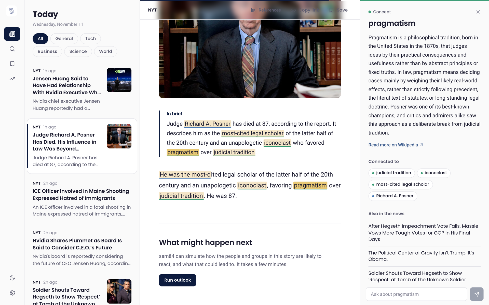
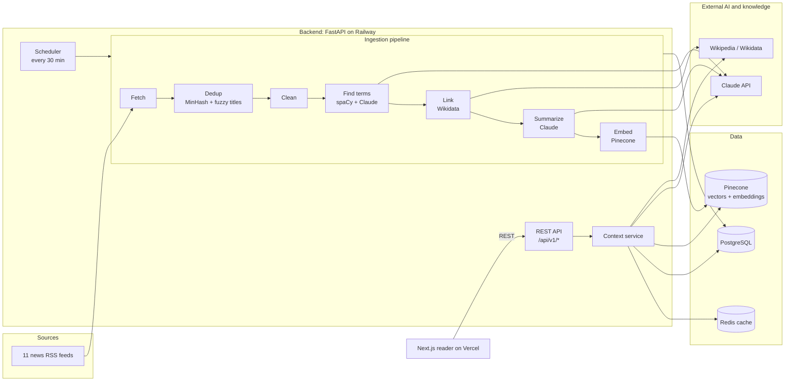

<div align="center">


# samā4

**News, understood.** A news reader that explains the people, places and ideas in a story, right beside the story.

[**Live app →**](https://frontend-roan-nine-nf5erh3avr.vercel.app) &nbsp;·&nbsp; [Waitlist](https://www.sama4.online) &nbsp;·&nbsp; [Architecture](#architecture) &nbsp;·&nbsp; [Engineering highlights](#engineering-highlights) &nbsp;·&nbsp; [Run it locally](#run-it-locally)


</div>



## The problem

News assumes you already know the backstory. A single headline can lean on a person, a court case, an acronym and a decade of policy at once. Readers who don't know them either open five tabs, paste paragraphs into a chatbot, or give up. Publishers lose younger readers right there.

## What samā4 does

| | |
|---|---|
| 📰 **Reads the news for you** | Every 30 minutes it pulls stories from 11 outlets (NYT, WSJ, Washington Post, Reuters, BBC, Al Jazeera, Nature and more), removes near-duplicate stories, and writes a short, neutral summary of each. |
| 🔎 **Finds what you might not know** | A two-stage pipeline picks out the terms a general reader would stumble on. Not just names like "Nvidia", but jargon and events like "quantitative tightening" or "the legal fight over the arch". |
| 💡 **Explains in place** | Click any highlighted term and a side panel explains it **in the context of this story**. The explanation is grounded in Wikipedia and in the article itself, and links to related terms and related coverage. |
| 💬 **Answers follow-ups** | Ask "why does this matter?" about any term and get a direct answer that draws on the article. |
| 🔮 **"What might happen next"** | An optional multi-agent simulation (via the MiroFish engine) predicts how the people and groups in a story are likely to react. |

## Architecture



**What happens when a reader clicks a term:**
1. **Cache:** Redis is checked first. Explanations are cached for 24 hours, so popular terms are instant.
2. **Gather context:** on a cache miss, the backend collects the term's Wikipedia summary and the passage of the newest story that mentions it.
3. **Explain:** Claude writes a 2–3 sentence explanation focused on why the term matters to that story.
4. **Connect:** related terms come from the database, and related coverage comes from a vector search in Pinecone.

### Tech stack

| Layer | Technology |
|---|---|
| Frontend | Next.js 14 (App Router), React 18, TypeScript (strict), TanStack Query, Tailwind CSS, Framer Motion |
| Backend | Python 3.11, FastAPI, async SQLAlchemy 2, Pydantic v2, APScheduler |
| AI / NLP | Claude (Anthropic API) for summaries, term detection and explanations; spaCy for named entities; Pinecone Inference for embeddings |
| Data | PostgreSQL, Redis, Pinecone (vector search) |
| Infra | Railway (API + Postgres + Redis), Vercel (web), Docker, GitHub Actions CI |
| Quality | pytest, Vitest, Ruff, ESLint, Prettier, 80+ automated tests |

## Engineering highlights

- **Hybrid term detection.** spaCy finds standard named entities, and common-knowledge ones like "United States" are filtered out. Claude then finds the knowledge gaps spaCy can't see: jargon, policies, acronyms and lesser-known people. The two lists are merged, deduplicated and ranked by priority, with exact character offsets so the UI can highlight in place.
- **Grounded, safe generation.** Explanations are built from Wikipedia plus the story's own text, and the prompts ask for neutral, output-only prose.
  - All Claude calls go through one client that sets the effort level per task: low for high-volume summaries, medium for reader questions.
  - Requests Claude declines on safety grounds automatically fall back to another Claude model.
- **Resilient ingestion.**
  - Each news source runs in its own transaction, and each article in its own savepoint, so one bad feed or article never loses the rest.
  - Near-duplicate stories are dropped with MinHash LSH plus fuzzy title matching.
  - Admin endpoints can re-run ingestion or regenerate every summary after a prompt change.
- **Clean, layered backend.** Routers → services → repositories (all SQL) → clients (one per external system).
  - A dependency-injection container builds each client once per process.
  - Every external service can be swapped for a fake in tests, so the whole suite runs offline in under a second.
- **Production-minded.**
  - CI runs lint, type checks, formatting checks and tests, with backend tests against a real Postgres. It also builds the Docker image and the Next.js app.
  - Secrets live only in the hosting platforms, and admin routes need a secret compared in constant time.
- **Built to extend.** Each package has an `AGENTS.md` describing its layering rules and step-by-step recipes (add an endpoint, a pipeline step, an external service), so human or AI contributors can add features safely.

## Project structure

```
backend/        FastAPI API + ingestion pipeline           → backend/AGENTS.md
  app/api/          HTTP routes and dependency injection
  app/services/     business logic (entity context, predictions)
  app/repositories/ all database queries
  app/clients/      Claude, Pinecone, Redis, Wikimedia, MiroFish
  app/ingestion/    fetch → dedup → clean → find terms → link → summarize → embed
frontend/       Next.js desktop reader                     → frontend/AGENTS.md
experiments/    Samvād voice companion (planned feature) and early prototypes
docs/           design prompts and product notes
```

## Run it locally

**Prerequisites:** Python 3.11+ with [Poetry](https://python-poetry.org), Node 20+, and Docker (for Postgres and Redis).

```bash
git clone https://github.com/juyal-devashish/Sama4.git && cd Sama4
cp .env.example .env          # add ANTHROPIC_API_KEY and PINECONE_API_KEY
make install                  # backend + frontend dependencies
make infra-up                 # Postgres + Redis in Docker
make dev-backend              # API on http://localhost:8000  (docs at /docs)
make dev-frontend             # web on http://localhost:3000  (second terminal)
make seed                     # optional: sample articles without calling any APIs
```

Without API keys the app still runs: new summaries show a placeholder, and term explanations use the sample text loaded by `make seed`.

**Quality gates:** `make check` runs exactly what CI runs: Ruff, ESLint, Prettier, TypeScript, pytest and Vitest. `make help` lists every command.

## API at a glance

| Method | Path | Purpose |
|---|---|---|
| `GET` | `/api/v1/feed?category=&page=&limit=` | Paginated stories with summaries |
| `GET` | `/api/v1/articles/{id}` | Article text with term positions for highlighting |
| `GET` | `/api/v1/articles/{id}/reference` | Every term in a story, grouped |
| `GET` | `/api/v1/context/{entity_id}` | Explanation of a term, plus related terms and articles |
| `POST` | `/api/v1/context/explain` | Answer a follow-up question about a term |
| `GET` | `/api/v1/predictions/*` | "What might happen next" simulations |
| `POST` | `/api/v1/admin/*` | Run ingestion, seed data, regenerate summaries (secret header) |

Interactive OpenAPI docs are served at `/docs` on any running backend.

## Roadmap

- **Semantic search** across all stories (the vector index is in place; the endpoint is next)
- **Samvād**: a voice companion that reads the news aloud and answers spoken questions (prototype in `experiments/samvad`)
- **Personalized depth**: explanations that adapt to what a reader already knows
- **Database migrations** with Alembic, as the schema starts to evolve

## Team

Built by **Devashish Juyal**, **Shreyash Methi** and **Shaivya Saini**.
